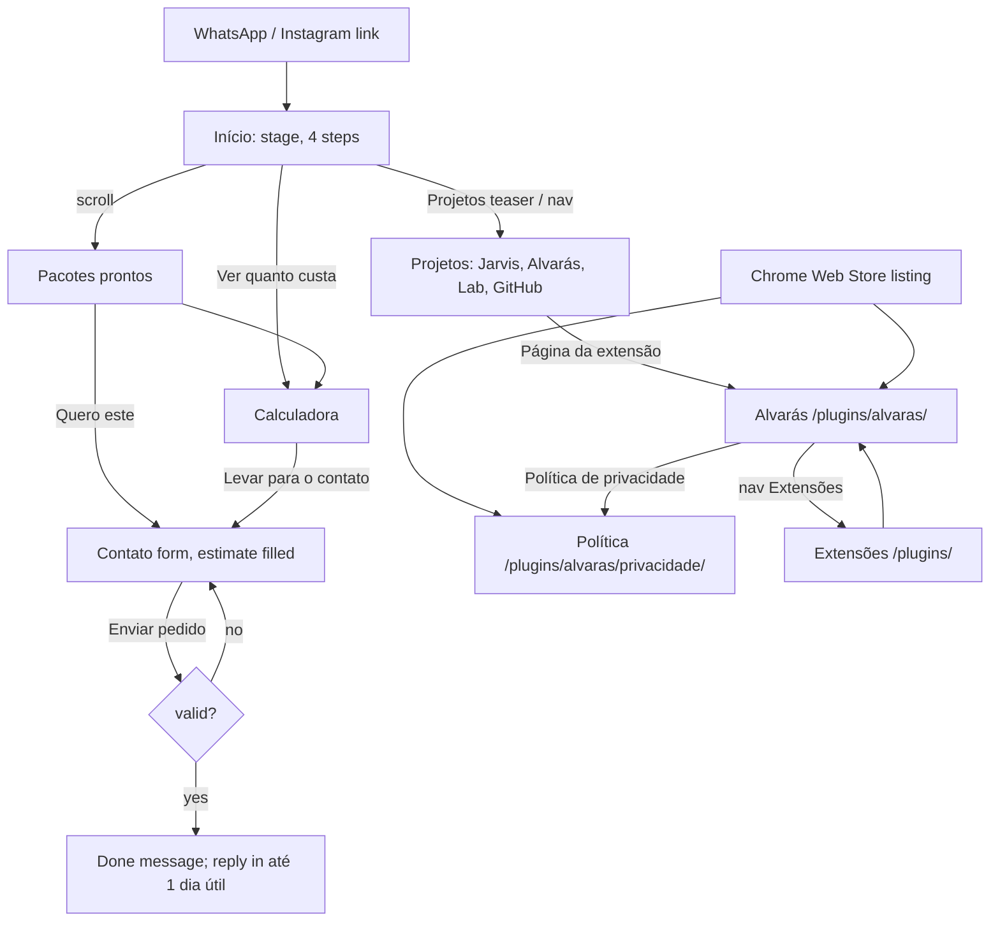

# Portfolio — design brief: "Traço"
A storefront for small-business sites that proves its craft as you scroll: on a dark stage, loose chalk lines gather into a site on a phone while the four steps (Conversa, Proposta, Sinal de 50%, Entrega) pass, ending on "O site é seu. Tudo dele é seu." After the stage the page turns calm and light: packages, a live estimate that feeds the form, who makes it, contact. At a glance: precise, sober, made by an engineer. The whole site is pt-BR. Mockups: `design/final/` (live pages, `shots/`); `design/final/style.css` is the reference CSS.

## Tokens (in css/tokens.css, names as they are)
The old beige desktop tokens go; `:root` takes the block at the top of `design/final/style.css`. Light is the default; dark comes from `prefers-color-scheme` (and `data-theme="dark"`, mock only).

| Token | Light | Dark | Use |
|---|---|---|---|
| `--background` | #E8ECEB | #0E1517 | page ground |
| `--surface` | #F7F9F8 | #152022 | inputs, diagram cards, policy table |
| `--text` | #0F1719 | #E6ECEA | body, strong rules (list tops, teaser) |
| `--textMuted` | #4C5A5C | #9AA8A9 | secondary copy, hints |
| `--primary` / `--primaryHover` | #A35A00 / #8A4C00 | #F2A93B / #FFC062 | buttons, ticks, live wires on light sections |
| `--onPrimary` | #FFFFFF | #1A1204 | text on primary |
| `--primarySoft` | #F1E2CB | #3A2C12 | launch tag, hot diagram node, `code` |
| `--border` | #C3CCCD | #2A3A3D | hairlines, inputs |
| `--wire` | #93A2A3 | #4A5C5D | diagram wires |
| `--danger` / `--success` | #B3261E / #1D6E43 | #FF8A80 / #7BD9A6 | form errors / done, "ok" facts |

Stage set, the same in both modes: `--stage` #0E1517, `--stage-2` #152022, `--stage-vignette` #16262A, `--stage-rule` #2A3A3D, `--stage-rule-strong` #3A4A4B, `--stage-grid` #2E3D3F, `--chalk` #D9E2E0, `--chalk-muted` #9BAAAB, `--chalk-dim` #7D8F91, `--amber` #F2A93B, `--amberHover` #FFC062, `--onAmber` #1A1204, `--amberSoft` #3A2C12.
Sizes: `--radius-s` 4px, `--radius-m` 8px, `--radius-pill`; `--space-1…9` = 4 8 12 16 24 32 48 72 112; `--wrap` 1180px, `--gutter` 20px, `--header-h` 64px, `--control-h` 48px, `--line` 1px, `--line-strong` 2px; type `--fs-hero --fs-finale --fs-page --fs-beat --fs-h2 --fs-h3 --fs-total --fs-price --fs-count --fs-lede --fs-body(17) --fs-small(15) --fs-micro(13)`, `--lh-*`, `--wdth-display` 125%, `--wdth-wide` 150%; motion `--dur-fast` .2s, `--dur-fade` .4s, `--ease-out`. Breakpoints (literal in media queries): 640, 760, 860, 960.

## Typography
- Display (h1–h3, wordmark, prices, totals): **Anybody** 700–900, width 100–150% (one variable file). Headings 800, width 125%; hero/finale/page titles 900 at 130–150%.
- Body / bodyStrong: **Hanken Grotesk** 400 / 600, tabular numerals everywhere. No mono (the policy's `code` uses the system mono).
- Self-host both in `fonts/` (add `fonts` to `SITE_DIRS`): woff2, latin subset, `font-display: swap`; Anybody one variable file (wght 700–900, wdth 100–150, ~40 KB), Hanken Grotesk 400 and 600 (~20 KB each). Preload only Anybody. No Google Fonts request on the live site (the mock uses it).

## Components
- **The stage** (signature, home only): `.spine` holds the sticky `<figure class="stage" data-studio="traco-wireframe">` (top `--header-h`, height `100svh − header`) and six `.beat` sections over it (`data-beat` 0–5: hero, Conversa, Proposta, Sinal, Entrega, O site é seu). Inside: `.stage-plate` (5 `<picture>` plates), `.stage-scene` (Studio's mount host: the scene's canvas), `.stage-progress` (4 bars + "Passo N de 4"; "Como funciona" on the hero; `hidden` until JS runs), a scrim (left on desktop, bottom on phone). The mock's "Studio · traco-wireframe" tag is **not built**, and the round-2 "ficha da peça" is gone: on the site the stage is just the stage.
- **Header** (every page): sticky, `--stage` with a `--stage-rule` bottom line; wordmark "Alysson", nav **Início · Projetos · Extensões** (current: chalk + 2px amber underline), "Pedir orçamento" amber button (→ `index.html#contato`), hidden under 640px. Works without JS.
- **Footer** (every page): `--stage`; wordmark, "Engenheiro de software. Construo sistemas com agentes de IA.", "© 2026 Alysson. Site estático, sem rastreadores e sem cookies."; links Início, Projetos, Extensões, GitHub, Pedir orçamento, Alvarás: privacidade.
- **Buttons**: amber (on the stage), primary (light sections), line; 48px tall, radius-s; hover darkens/lightens; `aria-disabled` at 45%.
- **Package row** (`.pkg`): name + description | "includes" ticks | price (`a partir de` only for Sistema sob medida), launch tag, timeline, "Quero este". Rows split by hairlines, a 2px primary line draws on hover/focus. Featured: Site institucional (primary button).
- **Calculator**: rows (radio for tier, checkbox per add-on, 56px+ tall, price right, bold when chosen), a stepper for "Páginas extras" (0–10), urgency row; the **quote card** (`--stage`, amber total, lines, "incluído", moved-tier note in amber, launch tag, the estimate note, "Levar para o contato"). Sticky on desktop; on phones a sticky `.peek` bar keeps the total in sight. Without JS: a note pointing to the packages.
- **Contact form**: Nome, E-mail ou telefone (hint), Mensagem, Estimativa (read-only; dashed when empty, primary-bordered when filled, "Tirar a estimativa"), LGPD note, "Enviar pedido". States: error per field + "Falta pouco: veja os campos marcados."; done in `--success`. It validates and stops until "Connect the contact form".
- **Live diagram** (`.diagram` + `flow.js`, Esquema's, restyled): `--surface` card, head "…" + pulsing "simulação ao vivo", nodes outlined in `--text` (ends in `--primary`), wires `--wire`, the packet and live wire `--primary`, hot node `--primarySoft`, a 3-line log. Idle off screen/hidden tab; reduced motion = still log of all routes.
- **Facts list** (`.facts`): term/value rows on hairlines; `.ok` in success. **Teaser**: a huge link row with a round arrow (Projetos, GitHub). **Dark page band** (`.page-hero`) tops every page but the home.

## Pages (exact copy is in the mockups; use it as written)
- **Início** (`index.html`): stage beats with "Seu site, traço a traço." (lede, "Ver quanto custa", "Como funciona", proofs), the four steps, "O site é seu. Tudo dele é seu." + Domínio/Código/Hospedagem/Acessos → **Pacotes prontos** (prices.json tiers, "includes", timelines, "preço de lançamento"; terms: 15 dias de garantia, sem mensalidade, urgência +30%, loja virtual) → **Quanto custa o seu?** → **Quem faz** ("Engenheiro de software. Construo sistemas com agentes de IA.", "sistemas que não podem parar", "Resposta em até 1 dia útil", GitHub) → **Projetos** teaser → **Conte o que você precisa** (form).
- **Projetos** (`projetos.html`, new URL): band "Projetos" → Jarvis (text, facts, diagram "Como um pedido anda no Jarvis") → Alvarás (text, facts, "Página da extensão" → `plugins/alvaras/`, "Política de privacidade" → `plugins/alvaras/privacidade/`) → Lab (3 "em breve" texts + diagram "Como uma mudança vai ao ar neste site") → GitHub teaser (https://github.com/alyhenr). No other apps.
- **Extensões** (`plugins/index.html`, frozen): band "Extensões", lede "Extensões de navegador que eu faço e mantenho. Cada uma tem sua página e sua política de privacidade."; the `js/plugins.js` list as package-style rows; `<noscript>` list kept; note on the fixed `/plugins/<nome>/privacidade/` addresses.
- **Alvarás** (`plugins/alvaras/`, frozen): mock `alvaras.html`: band with "Instalar no Chrome" + facts, O problema / O que a extensão faz, the two screenshots (WebP), Privacidade + Instalação (Firefox "em revisão", disabled), "Voltar para as extensões".
- **Política** (`plugins/alvaras/privacidade/`, frozen): mock `privacidade.html`: `.doc` column (42rem) on the page ground, verbatim text, table restyled; static, no JS.
- **404**: root-absolute paths, band "Página não encontrada", "O endereço pode ter mudado ou ter um erro de digitação.", the requested path, buttons Início / Extensões / Pedir orçamento.

## How the page drives the stage
Reference: `design/final/stage.js`. Contract (Studio's package README, vendor/studio/traco-wireframe): `mount(el, { progress 0–1, reducedMotion, palette {background, vignette, chalk, dim, grid, amber from the tokens}, onReady({ firstFrameMs }), onBeat(1–5), onError }) → { update, destroy }`; the site's `js/stage.js` drives it.
- `progress` is piecewise per beat section (reference line: mid-viewport): hero 0–.15, Conversa .15–.30, Proposta .30–.50, Sinal .50–.72, Entrega .72–.90, finale .90–1; rAF-throttled on scroll/resize.
- Plates (Studio's, rendered from the scene at each beat's still; on the site `img/plates/{phone-0N, desktop-0N-1280, -1920}` WebP + JPEG): plate 1 below .30, 2 below .50, 3 below .72, 4 below .90, then 5; 400 ms crossfade. Cropped around the scene's own centre (`object-position` 70% 50% wide, 50% 31% on phones) so plate and scene line up. Plate 1 eager + `fetchpriority=high`, 2–5 `fetchpriority=low`. Without the scene the counter follows the section in view.
- The scene loads after `load` and the first contentful paint, when idle (dynamic import of `js/scene/traco-wireframe.js`, ≤ 140 KB gzip), only with WebGL 2, no reduced motion, no Save-Data, `deviceMemory > 2`; after `onReady`, the warm frames' median (6 frames after one skipped) over 33 ms → destroy, back to plates (the first frame, with the shader compile, isn't judged). Otherwise `.stage.is-live` fades the plates out and the counter follows `onBeat` (beat 1 covers the hero and Conversa, beat 5 holds step 4). `onError` or reduced motion turning on: the scene goes, plates return. No JS: plate 1 stays, all text readable.

## Prices
Source: `vendor/web/prices` 1.1.0. The calculator imports `quote()`/`formatBRL()` and fetches `prices.json` (stage both into the site, e.g. `js/prices/`); the per-option helper lines are copy in the page script. Package figures are written in the HTML (crawlers, no JS) and a test compares them with prices.json. Form text: "Calculadora: <tier> (a partir de <tier escolhido>). <linhas>. Total R$ X, <prazo>, preço de lançamento. É uma estimativa." / "Pacote <nome>: R$ X (preço de lançamento), <prazo>."

## User flow

## Screens
`design/final/shots/` (phone 390 @2x, desktop 1440): `*-index-*` (stage beats, pacotes, calculadora, sobre, projetos, contato), `*-index-dark-*` (light sections in dark, form errors), `*-projetos-*` and `*-projetos-dark-*`, `*-alvaras-*`, `*-privacidade-politica`. Remake: `node design/tools/shots-final.mjs`.

## Studio pieces
| Piece | Where it mounts | Size | Scene direction |
|---|---|---|---|
| traco-wireframe | Início, `.stage-scene` inside `.stage` in `.spine` | full width × (100svh − header), sticky over 6 beats | [design/scenes/traco-wireframe.md](design/scenes/traco-wireframe.md) |
Made by Studio, never by the builder: traco-wireframe 1.0.0 is vendored in `vendor/studio/traco-wireframe/` and mounted on the stage; a change to it goes back to Studio as a new version.

## Don'ts
- Never the word "sênior", anywhere. He is "engenheiro de software".
- No phone number or e-mail address shown (except inside the verbatim policy, see notes); contact is the form only.
- No beige, bevels, windows, menu bar, status bar or terminal: the old desktop look is gone (remove `js/terminal.js`/`filesystem.js` use).
- No colour or size outside tokens.css; amber/primary only for actions, live state, ticks, the launch tag; one soft shadow (the phone `.peek`), nothing else.
- Never reword the policy; never move the frozen URLs or change the nav hrefs (labels change to Início, Projetos, Extensões).
- No eyebrow labels over headings (the step counters are the only exception: they are the sequence), no cards grid, no gradient text.
- Don't fake the scene in CSS: the plates are Studio's renders of the scene, and its fallback.

## Changed versus 01-traco
Shared header/footer on every page (nav Início, Projetos, Extensões; header solid, sticky, no JS); stage counter reads "Passo N de 4"; Studio tag and ficha dropped; packages and calculator rebuilt on prices.json 1.1.0 + quote.mjs (tier radios, extra pages, add-ons, urgency, moved-tier note, launch tag, terms); phone total bar in the calculator; "sênior" removed, the owner's AI line added (Quem faz, footer); Projetos uses Esquema's live diagrams (Jarvis + a new Lab diagram), facts lists instead of eyebrows, "extensão" wording; extension pages and policy mocked in the new look; fonts trimmed to Anybody 700–900 + Hanken 400/600, self-hosted; plates as WebP/JPEG at 3 sizes; reduced motion keeps the 400 ms plate crossfade; every hardcoded colour moved into tokens.
